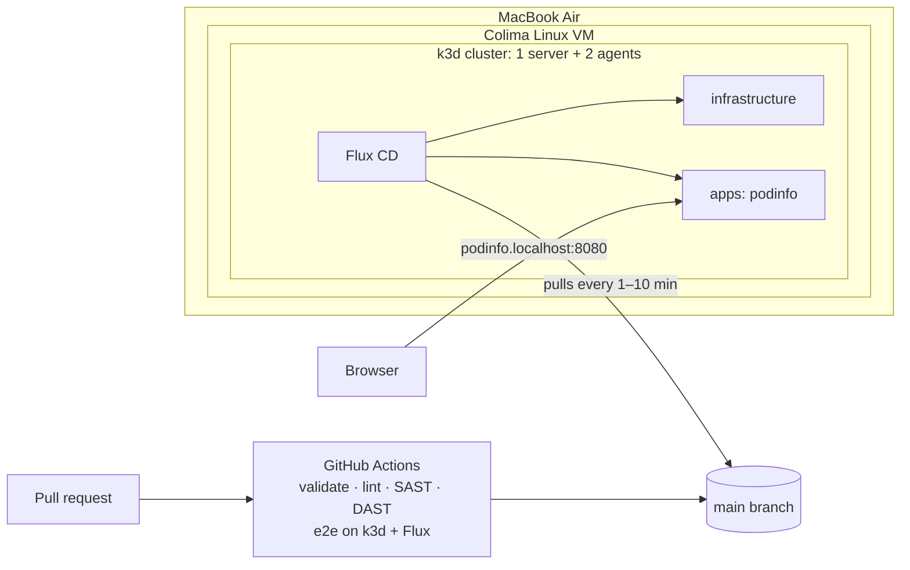

# K8S-Homelab

[](https://github.com/Hawuawu/K8S-Homelab/actions/workflows/ci.yml)
[](https://github.com/Hawuawu/K8S-Homelab/actions/workflows/security.yml)
[](https://github.com/Hawuawu/K8S-Homelab/actions/workflows/codeql.yml)


[](LICENSE)

A home Kubernetes lab that runs on a MacBook Air and is **operated entirely from GitHub**.
Nothing is deployed with `kubectl apply` by hand: a change is a pull request, CI proves it works
on a throwaway cluster, and after merge the lab pulls it in by itself.

## Why

Production Kubernetes teams work GitOps-style: Git is the single source of truth, every change is reviewed,
and the cluster converges to what is in Git. This repo brings that workflow to a laptop, so it can be learned,
demonstrated and reused without cloud costs:

- **Reproducible** — the whole lab can be deleted and rebuilt from this repo in minutes.
- **Reviewed** — every change goes through a PR with schema validation, policy checks, SAST/DAST and a real end-to-end deploy.
- **Secure by default** — no inbound ports (the cluster pulls from GitHub), secrets committed only encrypted (SOPS + age),
  workloads run non-root with a read-only filesystem under the `restricted` Pod Security Standard,
  behind Traefik security headers (CSP, frame and MIME-sniffing protection).
- **Portable** — the same manifests work on an always-on mini PC later; only the bootstrap changes.

## How it works



| Layer | Tool | Role |
|---|---|---|
| VM | [Colima](https://github.com/abiosoft/colima) | Lightweight Linux VM with Docker on Apple Silicon |
| Kubernetes | [k3d](https://k3d.io) / [k3s](https://k3s.io) | Multi-node cluster inside Docker, Traefik ingress built in |
| GitOps | [Flux CD](https://fluxcd.io) | Reconciles `clusters/lab` from this repo |
| Secrets | [SOPS](https://getsops.io) + [age](https://age-encryption.org) | Encrypted in Git, decrypted only inside the cluster |
| Sample app | [podinfo](https://github.com/stefanprodan/podinfo) | Hardened Deployment + Service + Ingress |

## Repository layout

```
bootstrap/k3d-lab.yaml     cluster definition (nodes, k3s version, port 8080 -> ingress)
clusters/lab/              what Flux applies: Kustomizations for infrastructure and apps
clusters/lab/flux-system/  Flux itself (generated, do not edit; see "Upgrading Flux")
infrastructure/lab/        cluster-wide pieces: namespaces, later ingress/cert-manager/monitoring
apps/base/<app>/           one folder per app
apps/lab/                  which apps the lab runs
scripts/                   validate, secret check, e2e test, badge generator
```

## Quick start (macOS, Apple Silicon)

```bash
make deps        # Homebrew: colima, docker, kubectl, k3d, flux, sops, age, linters
make up          # Colima VM (4 CPU / 8 GB) + k3d cluster
make sops-key    # one-time age key; commit the updated .sops.yaml
make bootstrap   # installs Flux and connects it to this repo (needs a GitHub token)
make open        # http://podinfo.localhost:8080
```

`make bootstrap` uses `flux bootstrap github`; see the
[Flux docs](https://fluxcd.io/flux/installation/bootstrap/github/) for the token it needs.
`main` only accepts pull requests, so the Flux manifests are already committed and bootstrap has nothing to push:
it installs Flux, adds a read-only deploy key and starts syncing.
Back up the age key from `make sops-key` in a password manager: it is the only way to decrypt the lab's secrets.

### Upgrading Flux

Upgrade the CLI (`brew upgrade flux`), then regenerate the manifests in a pull request and merge it; Flux upgrades itself:

```bash
flux install --export > clusters/lab/flux-system/gotk-components.yaml
```

Day to day: `make stop` / `make start` (state is kept), `make status`, `make destroy` (Git still has everything).
The lab only runs while the Mac is awake; Flux catches up after wake.

## Changing the lab

**Add an app:** create `apps/base/<app>/` with a `kustomization.yaml`, list it in `apps/lab/kustomization.yaml`,
open a PR. After merge, Flux deploys it.

**Add a secret:** write a Secret manifest named `<name>.sops.yaml`, then

```bash
sops --encrypt --in-place apps/base/<app>/<name>.sops.yaml
```

CI and the pre-commit hook reject any plaintext `kind: Secret`.

**Run the checks locally:** `make lint` (validate + yamllint + shellcheck + kube-linter), `make test`,
`make e2e` (`MODE=kustomize` deploys without GitHub).

## Quality and security gates

| Check | Tool | Where |
|---|---|---|
| Manifest schemas (Kubernetes + Flux CRDs) | kubeconform `-strict` | CI · `make validate` |
| No plaintext secrets + tooling tests | `scripts/check-secrets.sh`, `scripts/test-check-secrets.sh` | CI · pre-commit |
| YAML and shell lint | yamllint `--strict`, shellcheck | CI · pre-commit |
| End-to-end GitOps deploy | k3d + Flux reconciling the PR commit, HTTP probe through ingress | CI |
| IaC policy | kube-linter (all built-in checks, documented exclusions) | Security |
| SAST | Semgrep (`p/kubernetes`, `p/github-actions`, `p/secrets`) | Security |
| Secret scanning | gitleaks, full history | Security · pre-commit |
| DAST | OWASP ZAP baseline against the deployed app | Security |
| Workflow analysis | CodeQL (`actions`) | CodeQL |
| Dependency updates | Dependabot (actions, container images) | weekly PRs |

All GitHub Actions are pinned to commit SHAs.

## Roadmap

- GitHub Actions self-hosted runners in the cluster (Actions Runner Controller)
- Private access from anywhere with Tailscale
- Monitoring (kube-prometheus-stack, sized for a laptop)
- An always-on node (mini PC) reusing the same `apps/` and `infrastructure/`

## License

[MIT](LICENSE)
